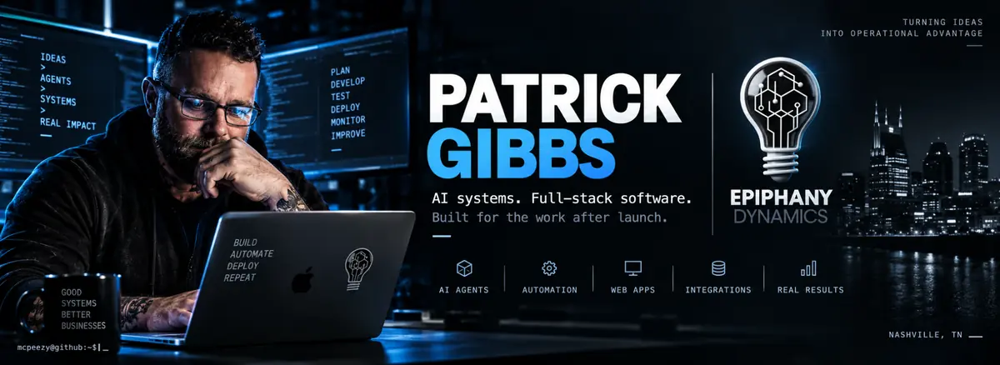
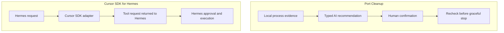

  

  <a href="https://patrickgibbs.dev"><strong>Portfolio</strong></a> &nbsp; / &nbsp;
  <a href="https://github.com/epiphany-dynamics"><strong>Open source</strong></a> &nbsp; / &nbsp;
  <a href="https://epiphanydynamics.ai"><strong>Epiphany Dynamics</strong></a>

## I build agents, workflows, websites and apps.

I'm Patrick Gibbs, founder of [Epiphany Dynamics](https://epiphanydynamics.ai). I build software for businesses, from the interface people use to the integrations that keep the work moving. I also repair systems that break when real customers use them.

Most of my public code lives in [@epiphany-dynamics](https://github.com/epiphany-dynamics). Client implementations stay private; the projects here are public tools, products, and reference implementations.

## Featured builds

<table>
<tr>
<td width="50%" valign="top">

<code>NATIVE MAC APP</code>

<h3><a href="https://github.com/epiphany-dynamics/port-cleanup">Port Cleanup</a></h3>

A native Mac app for reviewing stale listening ports. Local evidence and typed AI recommendations inform the decision; you confirm every stop.

<code>Swift</code> <code>SwiftUI</code> <code>macOS</code>

<a href="https://github.com/epiphany-dynamics/port-cleanup#safety-model">Safety model</a> · <a href="https://github.com/epiphany-dynamics/port-cleanup/releases/latest">Download</a>

</td>
<td width="50%" valign="top">

<code>EXPERIMENTAL INTEGRATION</code>

<h3><a href="https://github.com/mcpeezy/hermes-cursor-sdk">Cursor SDK for Hermes</a></h3>

Connect Hermes to the official Cursor Agent SDK through a provider plugin. Hermes remains responsible for tool approvals and execution.

<code>Python</code> <code>JavaScript</code> <code>Cursor SDK</code>

<strong>Subscription-oriented, not a promise of included inference.</strong> Cursor controls entitlement and billing. Offline tests don't establish live permission equivalence.

<a href="https://github.com/mcpeezy/hermes-cursor-sdk#install">Setup</a> · <a href="https://github.com/mcpeezy/hermes-cursor-sdk#verification-and-limits">Verification and limits</a>

</td>
</tr>
<tr>
<td width="50%" valign="top">
<h3><a href="https://github.com/epiphany-dynamics/epiphany-learn">Epiphany Learn</a></h3>

AI lessons with quizzes, progress tracking, and rewards. Browser-local progress works without an account; optional sign-in supports cross-device sync.

<code>Next.js</code> <code>TypeScript</code> <code>Firebase</code>

<a href="https://epiphany.help">Try the course</a> · <a href="https://github.com/epiphany-dynamics/epiphany-learn">Source</a>

</td>
<td width="50%" valign="top">
<h3><a href="https://github.com/epiphany-dynamics/supabase-ledger-hardening-kit">Supabase Ledger Hardening Kit</a></h3>

Reference patterns for row-locked balances, access-control checks, and concurrent writes. Database-backed verification needs a configured test environment.

<code>PostgreSQL</code> <code>Supabase</code> <code>k6</code>

<a href="https://github.com/epiphany-dynamics/supabase-ledger-hardening-kit#quick-start">Run the examples</a> · <a href="https://github.com/epiphany-dynamics/supabase-ledger-hardening-kit#known-limits">Known limits</a>

</td>
</tr>
</table>

## Choose your route

| I want to... | Start here |
| --- | --- |
| Connect Hermes to Cursor | [Cursor SDK provider](https://github.com/mcpeezy/hermes-cursor-sdk) |
| Inspect ports on my Mac | [Port Cleanup](https://github.com/epiphany-dynamics/port-cleanup) |
| See client work | [Patrick's portfolio](https://patrickgibbs.dev) |
| Learn the AI basics | [Epiphany Learn](https://epiphany.help) |

<strong>Open the systems lab: where does the human stay in control?</strong>

These diagrams describe the intended boundaries, not a certification of safety.

Port Cleanup never stops a process automatically. The Cursor adapter is experimental; its offline tests don't prove live billing or permission equivalence. Read each repository's limits before use.

<strong>More open-source work</strong>

| Project | Focus |
| --- | --- |
| [Prime Desktop](https://github.com/epiphany-dynamics/prime-desktop) | Early public macOS client for Prime Agent with split-pane chats and live attachment. [Known limits](https://github.com/epiphany-dynamics/prime-desktop/blob/main/docs/KNOWN_LIMITS.md). |
| [Resilient Data Source Kit](https://github.com/epiphany-dynamics/resilient-data-source-kit) | Backoff, circuit breaking, and confidence-scored entity matching. |
| [Email Delivery Fallback Kit](https://github.com/epiphany-dynamics/nocode-email-fallback-kit) | Webhook validation, transactional email, and delivery-event tracking. |
| [Call Speaker Diarization Kit](https://github.com/epiphany-dynamics/call-speaker-diarization-kit) | Known-speaker matching with human-review thresholds. Embedding and transcription calls are mocked. |
| [Claude Skills Portfolio](https://github.com/epiphany-dynamics/claude-skills-portfolio) | Business-workflow skills and a configurable presentation generator. |
| [Claude Discord Relay](https://github.com/epiphany-dynamics/clawd-discord-relay) | Per-channel agent routing and persistent sessions. |
| [Field Service Stack](https://github.com/epiphany-dynamics/fieldservicestack) | An Astro publishing system for software reviews and guides. |

<strong>Upstream contributions and reports</strong>

Selected public submissions to [Hermes Agent](https://github.com/NousResearch/hermes-agent). Follow each link for its current status.

- [WhatsApp capability documentation](https://github.com/NousResearch/hermes-agent/pull/94256): a Baileys-versus-Cloud feature matrix.
- [Technical-writing skill](https://github.com/NousResearch/hermes-agent/pull/93497): a checklist and tests for repository documentation.
- [SQLite connection-lifecycle bug report](https://github.com/NousResearch/hermes-agent/issues/79742): a reproduction and proposed fix for accumulating read connections.

## What I pay attention to

The failure path matters as much as the happy path. I look for bounded retries, explicit access rules, useful tests, and a way to verify the final result. A delivery event, stored record, or correct balance tells you more than a success message.

**Working stack:** TypeScript, JavaScript, Python, SQL, Swift · React, Next.js, Astro, Electron · PostgreSQL, Supabase, Firebase · APIs and webhooks.

---

**Have a workflow or build in mind?** [See my work](https://patrickgibbs.dev) or [book a conversation](https://epiphanydynamics.ai/book).
